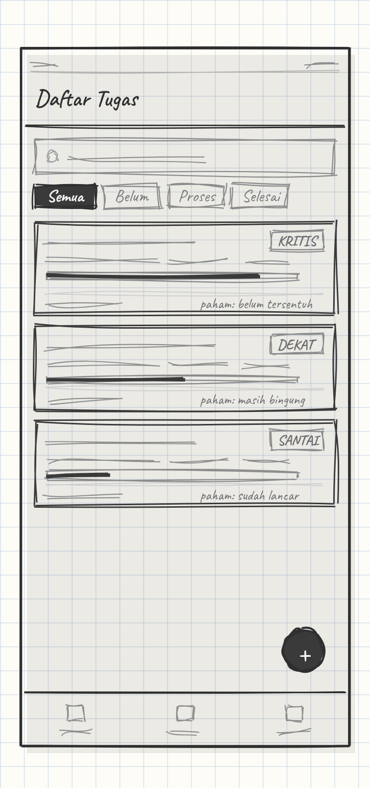
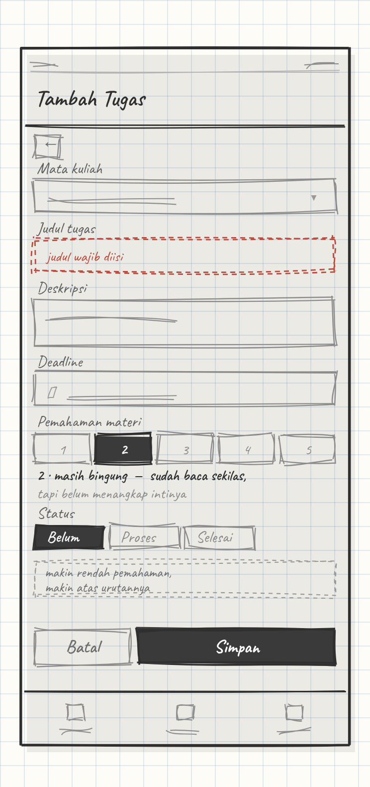
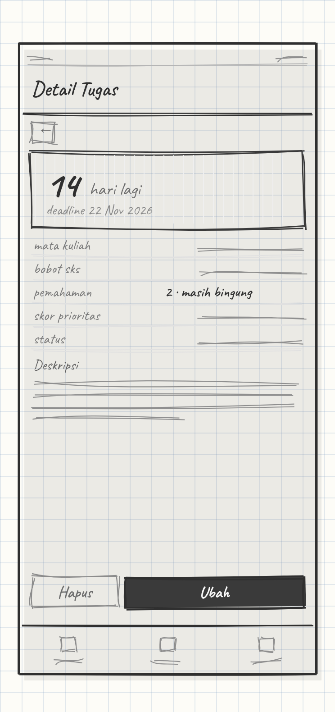

# task-tugas-akhir

Aplikasi mobile Flutter untuk memantau dan memprioritaskan tugas perkuliahan
berdasarkan bobot mata kuliah, tingkat pemahaman materi, dan sisa waktu menuju deadline.

> **Masalah yang diselesaikan:** mahasiswa tidak kekurangan daftar tugas. Yang tidak ada
> adalah cara menentukan mana yang harus dikerjakan lebih dulu — karena deadline terdekat
> belum tentu yang paling penting.

Dibuat untuk memenuhi **UAS Praktikum Mobile Programming**.

## Masalah

> **Mahasiswa tidak kekurangan daftar tugas — yang tidak ada adalah cara menentukan
> mana yang harus dikerjakan lebih dulu.**

Tugas dari beberapa mata kuliah datang hampir bersamaan dengan deadline yang berdekatan.
Aplikasi to-do list biasa hanya menampilkan daftar itu apa adanya, urut sesuai waktu
ditambahkan atau sesuai tanggal deadline. Akibatnya:

- **Deadline terdekat belum tentu yang paling penting.** Tugas ringan dari mata kuliah
  2 SKS bisa menutupi tugas berat dari mata kuliah 4 SKS yang sebenarnya lebih menentukan
  nilai.
- **Yang paling mendesak justru sering terlewat**, karena yang paling dekat tanggalnya
  belum tentu yang paling besar bobotnya.
- **Mahasiswa mengerjakan berdasarkan urutan yang terasa mendesak**, bukan yang terukur.
  Keputusan diambil pakai perasaan, bukan angka.

### Sasaran pengguna

| Aspek | Keterangan |
| --- | --- |
| **Siapa** | Mahasiswa aktif yang mengambil 5–8 mata kuliah per semester |
| **Kondisi** | Menerima tugas dari banyak mata kuliah dengan deadline berdekatan |
| **Kebiasaan sekarang** | Mencatat di buku, Google Tasks, atau grup WhatsApp — semuanya berupa daftar tanpa bobot |
| **Yang dibutuhkan** | Urutan pengerjaan yang bisa dipertanggungjawabkan, bukan sekadar daftar |
| **Kemampuan teknis** | Terbiasa aplikasi mobile sehari-hari, tidak perlu dipandu |

## Solusi dan korelasinya dengan masalah

Aplikasi ini tidak menambah satu daftar tugas lagi. Yang ditambahkan adalah **satu angka
yang menjawab "kerjakan yang mana dulu"**, dihitung dari tiga hal yang menentukan
mendesak atau tidaknya sebuah tugas:

```
skor = (sks × (6 − pemahaman)) / sisa_hari
```

| Masalah | Yang dipakai di rumus | Akibatnya pada daftar tugas |
| --- | --- | --- |
| Deadline terdekat belum tentu paling penting | `sks` — bobot mata kuliah | Tugas dari mata kuliah berbobot besar naik peringkat, tidak tenggelam oleh tugas ringan |
| Tugas berat justru yang paling belum dipahami | `pemahaman` (1–5) — makin rendah pemahaman, makin mendesak | Tugas yang materinya belum dikuasai naik peringkat, karena itu yang paling berisiko |
| Yang mendesak sering terlewat | `sisa_hari` — pembagi | Semakin dekat deadline, skor naik. Sisa 1 hari mengalahkan sisa 14 hari |
| Urutan ditentukan perasaan | Diurutkan menurun berdasarkan skor | Urutan bisa dijelaskan: "ini di atas karena SKS-nya besar, belum paham, dan sisanya 2 hari" |

### Kenapa pemahaman, bukan tingkat kesulitan

Rancangan awal memakai "tingkat kesulitan", tapi dibatalkan karena tiga alasan:

1. **Tidak bisa diverifikasi.** "Sulit" itu ambigu — sulit karena lama, karena banyak,
   atau karena bingung? Dua mahasiswa bisa memberi angka jauh berbeda untuk tugas yang
   sama. "Sudah paham belum?" ada jawaban jujurnya.
2. **Hasilnya tidak memberi instruksi.** Skor tinggi karena sulit hanya berarti
   "kerjakan ini" — itu yang pengguna sudah tahu. Skor tinggi karena pemahaman rendah
   berarti "pelajari dulu materinya". Beda besar bagi aplikasi yang tugasnya menyuruh
   orang melakukan sesuatu.
3. **Arahnya bisa dibalik dengan jelas.** Pemahaman tinggi berarti tugas itu justru
   *kurang* mendesak. Karena itu rumusnya memakai `(6 − pemahaman)`, bukan `pemahaman`
   langsung. Nilai 1 (belum paham) menghasilkan bobot 5, nilai 5 (sudah paham)
   menghasilkan bobot 1 — bukan 0, karena tugasnya tetap harus dikerjakan.

### Jangkar pemahaman 1–5

Skala tanpa definisi akan diisi asal. Karena itu tiap angka punya arti yang tetap, dan
label ini ditampilkan langsung di aplikasi saat pengguna mengisi form:

| Nilai | Label di aplikasi | Arti |
| --- | --- | --- |
| 1 | Belum tersentuh | Belum buka materi atau baca soalnya sama sekali |
| 2 | Masih bingung | Sudah baca sekilas, tapi belum menangkap intinya |
| 3 | Paham konsep | Mengerti teorinya, belum bisa mengerjakan sendiri |
| 4 | Bisa, perlu contekan | Bisa mengerjakan, masih perlu buka referensi |
| 5 | Sudah lancar | Bisa mengerjakan tanpa bantuan |

Label pendek (kolom kedua) dipakai pada tombol pemilih 1–5 di aplikasi, karena ruang
layar sempit. Arti lengkapnya muncul sebagai teks bantuan di bawah tombol setelah salah
satu angka dipilih. Dengan begitu pengguna tidak perlu menghafal skalanya, dan aslab bisa
langsung melihat dasar penilaiannya.

Konsekuensi yang perlu disadari: **rumus ini menempatkan urgensi di atas kemudahan.**
Tugas ringan yang harus selesai besok tetap masuk kategori dekat, tapi tugas berat yang
deadline-nya dua minggu bisa berada di atasnya. Itu memang disengaja — yang dicari bukan
"apa yang bisa cepat selesai", melainkan "apa yang paling mahal kalau terlewat".

Skor dihitung di sisi Flutter (bukan disimpan di database) karena `sisa_hari` berubah
setiap hari. Kalau disimpan, nilainya akan basi setiap tengah malam dan butuh proses
pembaruan tersendiri.

Setiap kartu tugas menampilkan skornya sebagai badge **KRITIS / DEKAT / SANTAI**, sehingga
keputusan bisa diambil tanpa membuka halaman detail lebih dulu.

Angka skor dari rumus ini **tidak dibatasi 0–1** — tugas dengan sisa 1 hari bisa bernilai 6,
tugas dengan sisa 14 hari bernilai 0,71. Karena itu badge tidak memakai ambang absolut,
melainkan perbandingan terhadap skor tertinggi di daftar saat itu:

| Badge | Syarat | Artinya |
| --- | --- | --- |
| **KRITIS** | skor ≥ 60% dari skor tertinggi | Mengerjakan hal lain lebih dulu berisiko kehilangan nilai besar |
| **DEKAT** | 25% – 59% | Perlu masuk rencana minggu ini |
| **SANTAI** | < 25% | Masih aman, tapi jangan sampai lupa |

Dua hal teknis yang harus ditangani di kode:

- **Sisa hari bisa nol** kalau deadline-nya hari ini. Pembagian dengan nol menghasilkan
  `Infinity`, jadi `sisa_hari` dibatasi minimal 1 sebelum dipakai.
- **Daftar kosong atau satu tugas** membuat "skor tertinggi" tidak bermakna sebagai
  pembanding. Untuk kasus itu badge dihitung langsung dari sisa hari, bukan dari rasio.

## Rancangan antarmuka

Wireframe sketsa tangan, 4 halaman, skala 1:1 (360 × 760 dp).
Berkas sumber: [`design/wireframe-kasar.html`](design/wireframe-kasar.html) —
render satu lembar dengan `design/wireframe-kasar@2x.png`.

<table>
<tr>
<td width="300" valign="top"></td>
<td valign="top">

**1. Daftar Tugas** — `/`

Halaman utama yang langsung menjawab pertanyaan "kerjain yang mana dulu?".

- Kolom cari menyaring judul dan deskripsi tugas.
- Chip filter memilih status: semua, belum, proses, selesai.
- Kartu tugas diurutkan menurun berdasarkan skor prioritas, bukan tanggal.
- Tiap kartu memuat nama mata kuliah, bobot SKS, sisa hari, dan label pemahaman,
  serta badge urgensi: **KRITIS**, **DEKAT**, atau **SANTAI**.
- Bar tipis di bawah judul menunjukkan besaran skor secara visual.
- Tombol `+` membuka form tambah tugas.
- Navigasi bawah berpindah antara Tugas, Mata Kuliah, dan Profil.

Data: `GET /tugas` (mendukung `?q=` dan `?status=`).

</td>
</tr>

<tr>
<td width="300" valign="top"></td>
<td valign="top">

**2. Tambah / Ubah Tugas** — `/form`

Satu halaman dipakai untuk dua keperluan: menambah tugas baru dan mengubah tugas lama.

- Mata kuliah dipilih dari daftar yang sudah ada, tidak diketik bebas,
  supaya bobot SKS-nya pasti ikut terbaca.
- Judul wajib diisi, deskripsi opsional.
- Deadline diambil lewat pemilih tanggal sehingga formatnya seragam.
- Pemahaman materi memakai tombol 1–5, bukan kolom teks, agar nilai di luar
  rentang tidak mungkin masuk. Di atas tombol ada label yang sedang dipilih, dan
  di bawahnya muncul arti lengkapnya — misalnya memilih 2 menampilkan
  "Masih bingung: sudah baca sekilas, tapi belum menangkap intinya".
- Status dipilih lewat chip.
- Setiap kolom punya pesan kesalahan sendiri di bawahnya. Contoh pada gambar
  adalah keadaan ketika judul dikosongkan.

Data: `POST /tugas` untuk data baru, `PUT /tugas/:id` untuk perubahan.

</td>
</tr>

<tr>
<td width="300" valign="top"></td>
<td valign="top">

**3. Detail Tugas** — `/detail`

Dibuka dengan menekan salah satu kartu di halaman daftar.

- Angka besar di atas adalah sisa hari menuju deadline, dihitung ulang setiap
  halaman dibuka.
- Tabel informasi memuat mata kuliah, bobot SKS, pemahaman materi beserta
  labelnya, skor prioritas beserta kategorinya, dan status terkini.
- Deskripsi ditampilkan penuh.
- Status bisa diganti langsung dari sini tanpa membuka form.
- Tombol hapus meminta konfirmasi lebih dulu, karena tindakan ini tidak bisa
  dibatalkan.

Data: `GET /tugas/:id` untuk isi halaman, `PUT /tugas/:id/status` untuk ganti
status cepat, `DELETE /tugas/:id` untuk hapus.

</td>
</tr>

<tr>
<td width="300" valign="top"></td>
<td valign="top">

**4. Mata Kuliah** — `/mata-kuliah`

Halaman pendukung. Bobot SKS yang diisi di sini adalah salah satu pembilang pada
rumus prioritas, jadi data mata kuliah harus benar lebih dulu.

- Daftar mata kuliah beserta jumlah tugas yang menempel padanya.
- Tiap baris bisa diubah atau dihapus.
- Form tambah berisi nama dan bobot SKS 1–6.
- Menghapus mata kuliah ikut menghapus seluruh tugas di dalamnya
  (`ON DELETE CASCADE`), karena itu ada peringatan sebelum tombol simpan.

Data: `GET` / `POST` / `PUT` / `DELETE /mata-kuliah`.

</td>
</tr>
</table>

## Alur halaman

```
Daftar Tugas ──tap kartu──> Detail Tugas ──tombol ubah──> Form (mode edit)
     │                                                          ▲
     └──tombol +──> Form (mode tambah) ─────────────────────────┘
     │
     └──navigasi bawah──> Mata Kuliah
```

Navigasi memakai named route, dan halaman Detail menerima `id` tugas lewat
`arguments` — sesuai pola Modul 08.

## Pemetaan ke modul praktikum

Struktur kode mengikuti pola yang dipakai modul, bukan pola baru. Bagian yang sengaja
dibuat berbeda hanya sumber data (API dan database), karena modul masih memakai
JSONPlaceholder dan API publik yang bersifat baca saja.

| Ketentuan UAS | Modul acuan | Implementasi |
| --- | --- | --- |
| UI (Row, Column, Card, TextField) | 03, 04, 05 | `Row`, `Column`, `Flexible`/`Expanded`, `SizedBox`, `Spacer`, `Card` |
| Daftar data | 06 | `ListView.builder` + kartu tugas |
| Navigasi minimal 3 halaman | 07, 08 | Named route + `arguments` saat ke halaman detail |
| Model & JSON | 10, 13 | Model class + `fromJson()` / `toJson()` |
| REST API | 10, 13 | package `http`, `GET`/`POST`/`PUT`/`DELETE` |
| Asynchronous | 13 | `Future`, `async`, `await` + loading/error state |
| State management | 11 | `GetX` — `GetxController`, `.obs`, `Obx`, `GetMaterialApp` |
| Form & validasi | 13 | `TextField`/`Form`, pesan kesalahan, `SnackBar` notifikasi |
| Fitur tambahan | 06, 09, 10 | Pencarian, filter status, sorting prioritas |

## Struktur proyek

Mengikuti pembagian `model` / `view` / `viewmodel` seperti pada Modul 10 dan 11.

```
lib/
├── main.dart                  // GetMaterialApp, tema, daftar named route
├── model/
│   ├── mata_kuliah.dart       // model + fromJson/toJson
│   ├── pemahaman.dart         // jangkar skala 1–5: label + arti tiap nilai
│   └── tugas.dart             // model + fromJson/toJson + getter skorPrioritas
├── view/
│   ├── home.dart              // daftar tugas + pencarian + filter
│   ├── form_tugas.dart        // form tambah/edit + validasi
│   ├── detail_tugas.dart      // detail + countdown
│   └── daftar_matakuliah.dart // CRUD mata kuliah
└── viewmodel/
    ├── tugas_controller.dart  // GetX controller + pemanggilan HTTP
    └── matakuliah_controller.dart
```

`model/pemahaman.dart` menyimpan jangkar skala sebagai satu sumber kebenaran, supaya
label yang muncul di form, di kartu daftar, dan di halaman detail tidak pernah berbeda:

```dart
class Pemahaman {
  static const label = {
    1: 'Belum tersentuh',
    2: 'Masih bingung',
    3: 'Paham konsep',
    4: 'Bisa, perlu contekan',
    5: 'Sudah lancar',
  };

  static const arti = {
    1: 'Belum buka materi atau baca soalnya sama sekali',
    2: 'Sudah baca sekilas, tapi belum menangkap intinya',
    3: 'Mengerti teorinya, belum bisa mengerjakan sendiri',
    4: 'Bisa mengerjakan, masih perlu buka referensi',
    5: 'Bisa mengerjakan tanpa bantuan',
  };

  // Dipakai rumus prioritas: makin rendah pemahaman, makin besar bobotnya.
  static int bobot(int pemahaman) => 6 - pemahaman;
}
```

Pemanggilan API diletakkan di dalam `viewmodel` seperti pada Modul 10 dan 13, sehingga
`view` hanya mengurus tampilan.

## Keterbatasan yang disadari

Bagian ini ditulis terbuka karena memengaruhi seberapa jauh hasil aplikasi bisa dipercaya.

- **`sisa_hari` mendominasi rumus.** Pengaruhnya berkali lipat dibanding `sks` dan
  `pemahaman`. Deadline 14 hari menuju 1 hari menaikkan skor 14 kali, sedangkan SKS 1
  menuju 4 hanya 4 kali. Akibatnya `sks` dan `pemahaman` efektif hanya menentukan urutan
  di antara tugas yang deadline-nya berdekatan. Tugas berbobot 4 SKS yang belum dipahami
  dengan sisa 14 hari bisa berada di bawah tugas 2 SKS yang sudah lancar dengan sisa
  1 hari. Secara praktis ini masih masuk akal, tapi bukan berarti rumusnya sempurna.
- **Pemahaman dinilai sendiri oleh pengguna.** Tidak ada verifikasi, jadi hasilnya
  bergantung pada kejujuran saat mengisi. Jangkar 1–5 hanya mengurangi ambiguitas,
  bukan menghilangkannya.
- **Ambang badge memakai skor relatif.** Kalau semua tugas kebetulan punya deadline jauh,
  yang tertinggi tetap akan berlabel KRITIS meskipun sebenarnya belum mendesak. Ini
  konsekuensi dari memakai perbandingan terhadap skor tertinggi.
- **Belum ada penanganan zona waktu.** `deadline` disimpan sebagai tanggal tanpa jam,
  sehingga "sisa hari" dihitung terhadap tanggal perangkat, bukan zona waktu kampus.

## Teknologi

- Flutter (Dart)
- GetX — state management dan routing
- package `http` — HTTP client
- package `intl` — format tanggal deadline
- Backend: REST API sendiri (Node.js + PostgreSQL), bukan JSONPlaceholder

## Menjalankan

```bash
flutter pub get
flutter run
```

Alamat API diletakkan pada `lib/config.dart` (tidak di-commit).

## Status

Dalam pengerjaan — UAS Praktikum Mobile Programming.
